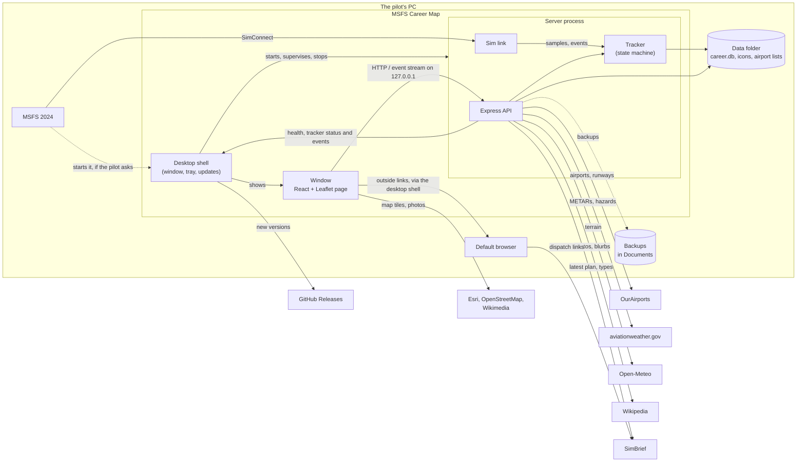
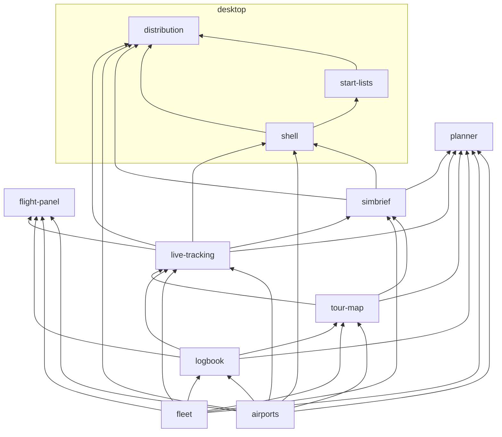

# High-Level Design: MSFS Career Map

## Problem

MSFS 2024 has no persistent career of the kind this project's pilot flies: every aircraft + livery
always starts where it last parked, so each one builds its own tour, and study-level add-ons (such
as A2A's) keep wear and failures per livery. With several tours running at once, it is hard to keep
track of where each aircraft is, where it has been and when, how each flight went, and where it can
go next. Ready-made career programs bring their own rules, economy and accounts; this career wants
none of that, only a faithful record of what was flown.

## Approach

A local, map-first logbook that the sim fills in by itself.

- **A Windows app beside the sim.** It installs, updates and uninstalls like any Windows program,
  opens in a window of its own and sits in the tray. Closing the window leaves it tracking, and the
  pilot can have it start with MSFS. The logbook lives apart from the program, so installing,
  updating or uninstalling never deletes or overwrites it.
- **The career is a set of tours.** The unit is an aircraft + livery. Its hops are chained in
  order, and where it is parked is simply the destination of its last hop — nothing to keep in sync.
- **The map is the main view.** Every tour is drawn where it was flown — the real recorded track
  when there is one — with where each aircraft is parked and when each airport was visited.
- **The sim logs the flights.** With MSFS running, a takeoff and a landing become a hop on their
  own, with the flown track, a rated landing, a flight profile and fuel figures. When the app cannot
  tell something (which aircraft, which airport), it keeps the leg for the user to finish rather
  than guessing. Hops can always be logged and corrected by hand too. For flying that is not part
  of the career, a **casual mode** switched on from the live card turns logging off until the
  pilot switches it off, quits the app or closes MSFS: the path flown is drawn behind the aircraft
  while the server runs, never stored and never tied to a fleet aircraft.
- **Planning hands off.** The app answers "where can this aircraft go next within N minutes?", with
  live weather and darkness flagged; SimBrief does the real flight planning, and its plan comes back
  to be kept with the flight.
- **Free, public data.** Airports and runways from OurAirports, weather from aviationweather.gov,
  terrain from Open-Meteo, photos and blurbs from Wikipedia — no accounts or keys.
- **Aircraft numbers researched once.** For every type in SimBrief's list, the performance an
  aircraft needs — cruise, climb and descent, runway, ceiling, crosswind — is researched up front
  from published, reputable sources and ships with the app, each value with its source, so adding
  an aircraft is choosing its type; a type outside the table is typed in by hand.

## Target Users

One sim pilot running their own career on their own PC. They fly sessions with the sim and the app
side by side, want logging to take no effort, plan the next hop between flights, and look back at
flights afterwards. They install it like any other Windows program and need nothing else
installed, no terminal, and no access to the database or the code. The developer runs the server
and page from source beside an installed copy.

## Goals

- Every flight flown with the sim connected, outside casual mode, ends up in the logbook, or
  waiting for the pilot to finish or discard it — never silently lost, not even across a restart
  of the app or its server, a sim crash, or the window being closed.
- Installing, updating and uninstalling work like any Windows program and need no terminal. None
  of them deletes or overwrites the logbook; a new version only upgrades it in place, additively,
  after backing it up.
- At a glance: where every aircraft is parked, the tour each has flown, and when each airport was
  visited.
- Choosing the next hop takes one search, with unusable airports filtered and doubtful ones flagged.
- Any tracked flight can be examined afterwards: profile, landing, distance, fuel, and the plan it
  was flown from.
- Hand-logged history is first-class: hops from before tracking, or flown without the app, sit in
  the same tours.

## Non-Goals

- **Restricting where the pilot can fly** — no career feature, now or later, limits destinations or
  refuses a flight. The app records the career; the pilot runs it.
- **An economy, for now** — no jobs, income or passengers to earn. A realistic running cost per
  tour (fuel and maintenance spent) is a possible later addition, deliberately deferred; hops
  already record the fuel each tracked flight used.
- **A flight planner** — no routes, winds or fuel planning beyond choosing a destination; SimBrief
  does that.
- **More than one user or machine** — no accounts, hosting or sync.
- **Reaching the app from another device, for now** — it listens only on the pilot's own PC; a
  tablet on the home network is a possible later opt-in.
- **Other operating systems** — the app is a Windows program, as MSFS on PC is.
- **Other simulators** — MSFS 2024 is the target; MSFS 2020 works without liveries.
- **Tracking aircraft wear or maintenance** — the add-ons that model it keep it themselves.

## Tenets

In order; when two conflict, the higher one wins.

- **Never lose a flight.** When a choice risks losing something the app recorded or the pilot
  logged, keep it and let the pilot discard it.
- **Out of the pilot's way while flying.** While the sim is connected, prefer waiting to
  interrupting: the app reports through the tray and notifications, and anything that would take
  focus, ask a question or restart the app by choice — an update included — waits until the sim
  closes, even when that leaves a pending leg or an update waiting longer.
- **Record, don't police.** The app records the career as flown; it may warn, or one day count the
  cost, but it never refuses a flight or limits where the pilot can fly.
- **A guest in the sim's house.** Leave what the sim and other programs share as the pilot set it,
  rather than reaching further into it: the sim's list of programs to start (`EXE.xml`) and
  Windows' start-up list gain an entry only when the pilot asks, are backed up first, and lose
  exactly that entry, and nothing else, when the pilot turns it off or uninstalls.
- **Hand off to the specialists.** Where a dedicated tool already does a job well — SimBrief for
  planning, add-ons for wear, the sim for flight data — integrate with it rather than rebuild it.
- **The page stays a web page.** When a feature could live in the desktop shell or in the server
  and page, it goes in the server and page, so it works the same in a plain browser tab, the
  browser tests cover it, and the window technology stays replaceable. The desktop shell keeps what
  a browser cannot do: the window and tray, the single running copy, keeping the server running,
  starting with MSFS or Windows, notifications, updates, and sending links out to the pilot's
  browser.
- **Proven over lean.** For what the app stands on — its runtime, packaging, installer and
  updater — prefer the widely used, maintained tool that does the whole job over a lighter one
  assembled from young or home-made parts, even at hundreds of megabytes beside the sim.
- **Keyless and local.** Prefer a free, keyless source and local storage over a better service that
  needs an account or a key.

## System Design

The app is a Windows desktop program built on Electron, in two processes:

- **The desktop shell** (Electron's main process) owns the window, the tray icon, the single running
  copy, starting with MSFS or with Windows, notifications and updates. It never opens the database;
  it learns what the tracker is doing from the server's API and event stream.
- **The server** — the Express API, the tracker and the sim link — runs in a process of its own. The
  desktop shell starts it, restarts it if it fails (giving up and saying why if it keeps failing
  as it starts), and asks it to shut down cleanly before quitting or updating.

The window shows the page the server serves on 127.0.0.1, the only address the server listens on,
at a fixed port of the installed app's own, apart from the ports used in development and tests, so
the page's remembered choices last. The server answers only requests addressed to it by its local
name and refuses changes asked for by other sites' pages. The page loads map tiles and photos
straight from their hosts; links to outside sites open in the pilot's default browser. Closing the
window leaves the server tracking behind the tray icon; Quit in the tray stops both. Updates come
from the project's GitHub Releases. They install when the pilot quits or chooses to restart for
one, or by themselves at a quiet moment — MSFS closed, the window shut and no leg in progress —
after which the app comes back in the tray.

The sim link only turns SimConnect into samples and events; the tracker is a sim-independent state
machine fed one sample at a time and checkpointed to the database every few seconds and whenever a
leg is logged or kept, so a synthetic feed can drive it and a restart never loses the leg — at
most its last few seconds. Only one server on the PC links to the sim at a time, so two copies
never log the same flight: the installed app links by default, while a copy run from source links
only when started with an explicit option, and then only while no other server holds the link. A
copy that cannot link says so on its live card.

**The data folder** — the logbook database, uploaded icons and airport lists — lives in the pilot's
local app-data folder, apart from the installed program, and is backed up automatically to their
Documents folder. The server does everything that touches it: it takes the backups and, on first
run, brings in a logbook from another data folder (such as a copy run from source), using SQLite's
own backup so nothing waiting in its write-ahead log is lost. The desktop shell decides when and
where, and passes those to the server. In development, the same server and page run from source
with npm and a browser tab, against a data folder of their own that keeps its backups beside it,
so neither a copy run from source nor a test ever writes to the pilot's backups.

### Segments

Each segment has a low-level design and EARS specs under `docs/intent/<segment>/`, and an arrow doc
under `docs/arrows/`. A group of segments that share intent sits under a design doc of its own,
which owns no specs: its segments' folders nest beneath it (`docs/intent/desktop/shell/`,
`docs/arrows/desktop/shell.md`).

| Segment | Prefix | Owns |
|---|---|---|
| [logbook](intent/logbook/logbook-design.md) | `LOG` | Hops: the record, order and parked position, the hop form and lists, correcting tracked hops |
| [fleet](intent/fleet/fleet-design.md) | `FLEET` | Aircraft + livery: performance and limits, the performance table by type, color and icon, sim binding fields, the aircraft form |
| [airports](intent/airports/airports-design.md) | `APT` | OurAirports data and its monthly refresh, code lookup, nearest airport, the airport popup, METARs, Wikipedia |
| [tour-map](intent/tour-map/tour-map-design.md) | `MAP` | The map: geometry and world copies, tours, airport dots, parked markers, highlight and zoom, night and hazard overlays |
| [planner](intent/planner/planner-design.md) | `PLAN` | Block-time model, reachable-airport search, weather and darkness flags, terrain check, the planner card and layers |
| [live-tracking](intent/live-tracking/live-tracking-design.md) | `LIVE` | Sim link (one per PC), leg detection, airport naming, landings and ratings, logging and pending legs, casual mode, the live card and layer |
| [flight-panel](intent/flight-panel/flight-panel-design.md) | `PANEL` | One flight under the map: profile chart, landing and flight cards, how ratings look |
| [simbrief](intent/simbrief/simbrief-design.md) | `SB` | Dispatch links, type list, importing and keeping plans, the SimBrief card and route |
| [app-shell](intent/app-shell/app-shell-design.md) | `APP` | Server startup and clean shutdown, data locations, backups and bringing in a logbook from another data folder or a backup, API conventions, page layout, shared formatting, development scripts and the test harness |
| [desktop](intent/desktop/desktop-design.md) | `DESK` | The installed app: a grouping of three segments under one design doc that holds what they share and owns no specs or arrow doc of its own. Each part has its design and specs under `docs/intent/desktop/<part>/`, its arrow doc under `docs/arrows/desktop/`, and a prefix extending `DESK`, so its spec IDs read like `DESK-SHELL-TRAY-001`: [shell](intent/desktop/shell/shell-design.md) (`DESK-SHELL`) — the window and tray, closing and quitting, the single running copy, supervising the server (its port, data folder and shutdown), first run, notifications, outside links and updates; [start lists](intent/desktop/start-lists/start-lists-design.md) (`DESK-START`) — starting with MSFS or Windows; [distribution](intent/desktop/distribution/distribution-design.md) (`DESK-DIST`) — packaging, installer and uninstaller, and releases |

An arrow points from a segment to one that relies on it (`docs/arrows/index.yaml` lists them all);
the desktop box holds its three segments. app-shell sits under everything and is left out.

### Rules every segment follows

- **Identity.** A fleet aircraft is a name + livery; a sim aircraft is matched to it by the sim's
  title + livery, a blank livery meaning any.
- **Order and position.** Hops are ordered per aircraft by a contiguous sequence the server
  renumbers; an aircraft is parked at its highest-sequence hop's destination, derived, never stored.
- **Airport codes** are resolved to the canonical OurAirports ident before storage; an airport a hop
  uses is never lost from the data.
- **Time.** Stored as ISO 8601 UTC, shown in the PC's local time. A hop records the real-world
  clock and the sim's clock; flight time leaves out time the sim was paused.
- **Map geometry** — paths, world copies, parked positions, zoom points — is computed in one place
  (`paths.ts`) and shared by every layer. The map wraps: every layer is drawn on every world copy
  in view, so two copies of a region never show different things.
- **The server decides, the page shows.** Landing ratings, hard planner filters and code resolution
  happen on the server; the page maps results to how they look.
- **Schema changes are additive** and upgrade an existing database in place.

## Key Design Decisions

| Decision | Chosen | Alternatives | Why |
|---|---|---|---|
| Shape of the app | A Windows desktop app: an Electron desktop shell supervising a local Node server in a process of its own, the page in the desktop shell's window, the logbook in one SQLite file | A browser tab on a server started from a console launcher; a single `.exe` built with Node's single-executable support, showing the page in a WebView2 (Edge) window; a Tauri (Rust) shell running the Node server as a bundled helper program; a hosted service | Installs, updates and uninstalls like any Windows program and keeps tracking with no window open. Electron ships its own Node, so the server — node:sqlite, Express, the event stream and the sim link — runs in it with only a bundle step and explicit data and program folders, and the desktop shell starts and restarts it with Electron's own API; the whole chain stays TypeScript and open source. The WebView2 shapes are lighter, but the single `.exe` needs a home-made window, updater and installer, and Tauri adds Rust while the server still ships as a separately built Node program. A hosted service needs hosting and sign-in, and the sim link needs a process on the same PC anyway. Costs: a few hundred megabytes of disk and memory beside the sim; a release at least every six months to stay on a supported Electron, more often for Chromium security fixes; and, until it is code-signed, a Windows SmartScreen warning at the first install. |
| Where the logbook lives | The data folder in the pilot's local app-data folder (`%LOCALAPPDATA%\MSFS Career Map`), with automatic backups in `Documents\MSFS Career Map\Backups` | Beside the program; Documents; the roaming app-data folder (`%APPDATA%`, where Electron keeps its own data by default) | The installer and updater replace the program's folder, and the uninstaller can clear Electron's own data folder; none of them reaches this one. A live SQLite database copied apart from its write-ahead log can be corrupted, so the live file stays out of synced and roamed folders, while finished backups go to Documents, which OneDrive folder backup and File History cover when the pilot has them on. |
| Closing the window | Leaves the app tracking behind the tray icon; Quit in the tray stops it | Closing quits; ask the first time | A closed window must not lose a flight; the tray icon shows the app is still running and holds Quit. |
| Which copy logs flights | The installed app; a copy run from source links to the sim only when started with an explicit option, and never while another server holds the link | The first copy to link wins; the installed app takes the link from a source copy | Career flights never land in a development data folder by accident, and nothing has to hand the link from one copy to another. |
| When updates install | On Quit, on Restart to update, and by themselves at a quiet moment: MSFS closed, the window shut, no leg in progress | Only when the pilot chooses; at a start not made by MSFS | An app that lives in the tray and is shut down with Windows would otherwise never update and fall off a supported Electron; a quiet moment interrupts nothing. |
| Starting with the sim | An opt-in setting that adds the app to the sim's list of programs to start (`EXE.xml`) | Added by the installer; added automatically; not offered | Starting with the sim is the surest way to have the app running for every flight, but an edit that leaves that shared file malformed stops every add-on listed in it from starting, so it changes only when the pilot asks. |
| Unit of the career | Aircraft + livery, hops chained per aircraft, parked position derived | Free-standing flights; a stored "current location" | Matches how the career is flown and how add-ons persist wear; a derived position cannot drift. |
| Tracker design | A sim-independent state machine fed samples, checkpointed every few seconds | Logic inside the SimConnect callbacks | Testable with a synthetic feed; survives restarts. |
| When unsure | Keep the leg as pending with the reason; the pilot finishes or discards it | Guess; drop | Nothing guessed into the logbook, nothing flown lost. |
| Flying outside the career | A casual mode on the tracker: no legs detected, the path flown kept in server memory only and drawn live | Turn tracking off; a throwaway fleet aircraft; discard each leg by hand; keep the path in the browser; discard each finished leg automatically | One switch, nothing written to the logbook. The switch itself is kept with the tracker's checkpoint, so the app's own server restarts do not end it; it ends when the pilot switches it off, quits the app or closes MSFS, so a new sim session never starts with logging off from the night before. Kept by the server, the path survives a page reload and looks the same in every window or tab; held in the server's memory, it is lost when the server stops. Discarding finished legs would lose the path at every full stop. |
| Data sources | Free, keyless public sources, cached locally | Commercial or keyed APIs | No sign-ups or keys for a local hobby tool. |
| Aircraft performance | A table of SimBrief's types researched once, by one written method, from manufacturers' and aviation authorities' publications and reputable trade journals, and, for a number none of those gives, from the publicly readable manual of an MSFS 2020 or 2024 add-on of the type; every value citing its source; a cruise speed or runway no such source gives taken from the nearest similar type in the table and marked as an estimate, any other value no such source gives left blank, or for a climb or descent input taken from the form's class preset and marked as such; shipped in the program and offered by the aircraft form, the pilot free to change any value | Each pilot types the numbers; class presets only; values looked up from an online source as the pilot adds an aircraft; real-world sources only, leaving their gaps blank; every gap left blank, the cruise speed and runway included; an estimate scaled from the similar type, or averaged over its class | Looking up eight numbers per aircraft is the slowest part of starting a career, and pilots fill them unevenly, which skews the planner. Researched once, the numbers are the same for everyone and can be checked; a value no reputable source gives is never passed off as sourced. Cruise speed and runway are the two numbers the planner leans on most — without a cruise speed it has no block time, and a blank runway admits every airport — so where no source gives them, the nearest similar type's figure, named and marked as an estimate, serves the pilot better than a blank; the other limits stay blank. The similar type's figure is taken as it stands, which anyone can check, rather than scaled by a formula that would claim more precision than it has. The table serves a flight sim: where no real-world document gives a number, the manual of an add-on that models the type gives the figure the pilot will fly, and the detailed ones reproduce the real flight manual's tables; real-world sources come first, so an add-on's figure never displaces one. A lookup at run time would depend on a service that publishes these numbers for every type, free and keyless, and no such service is known. Cost: the table is only as current as the program, a type SimBrief adds later is typed in by hand until a release adds it, an add-on manual's figure may follow that add-on's flight model rather than the aircraft, and an estimate is only as close as the similar type. |
| Planning | Choose the destination here; plan the flight in SimBrief and import the plan | Build route, wind and fuel planning in | SimBrief already does it well. |
| Spec IDs | `PREFIX-FACET-NNN`, one prefix per segment; a segment inside a group extends the group's prefix (`DESK-SHELL-TRAY-001`) | Global numbering | IDs say where they belong and survive reordering, and a prefix search gathers a whole group. |
| Testing | Vitest for the logic (tracker, geometry, block-time model, OFP parsing) and for the API against a temporary database; component tests with Testing Library for UI specs; a few Playwright browser tests for the main flows (log a hop, a `sim-fake` flight, plan → Use); a smoke test of the packaged app for what only the desktop shell does. Tests cite the spec IDs they verify and are written before the code that closes a gap. | Logic only; logic plus component tests, UI checked by hand | Much of the app's value lies in flows that cross the tracker, the server and the page; the synthetic sim feed makes a whole tracked flight testable without the sim. Because the page stays a web page, the browser tests cover it without the desktop shell, and the packaged smoke test covers what is left: the window, the tray, the single running copy and shutting down. The smoke test runs the packaged app on a data folder, port and instance of its own, with no sim link, and never touches the sim's or Windows' start-up lists, so it neither opens the real logbook nor meets a running installed copy. |

## Success Metrics

The project is broken when any of these happens:

- A flight flown with the sim connected and casual mode off appears neither as a hop nor as a
  pending leg.
- A restart of the app or its server, or a sim crash in flight, loses the leg being flown.
- Closing the window stops tracking.
- The app takes focus, asks a question or restarts itself by choice, an update included, while the
  sim is connected.
- Installing, updating or uninstalling the app loses anything in the logbook, or a new version
  upgrades it without first backing it up.
- The same flight is logged twice because two copies of the app ran at once.
- The sim's list of programs to start or Windows' start-up list gains an entry for the app without
  the pilot asking, keeps it after the pilot turns the setting off or uninstalls, or loses or
  changes any entry the app did not add.
- Switching to casual mode drops a fleet aircraft's leg in progress without the pilot confirming it.
- The map shows an aircraft parked anywhere but its last hop's destination, a hop's path not
  meeting its airport dots, or two copies of the same region in view showing different paths, dots
  or layers.
- A planner result offers an airport the aircraft cannot use (runway, surface, elevation) or hides
  one that live weather does not rule out.
- Logging a normal flight needs anything from the pilot beyond binding a new sim aircraft once.

## References

- [README.md](../README.md) — user-facing description, API table, roadmap
- [CLAUDE.md](../CLAUDE.md) — project notes and LID directives
- [docs/arrows/index.yaml](arrows/index.yaml) — segment status and dependencies
- External: OurAirports, aviationweather.gov, Open-Meteo, Wikipedia REST API, SimBrief, SimConnect
  via node-simconnect; Electron, electron-builder (NSIS installer), electron-updater and GitHub
  Releases for the desktop app
