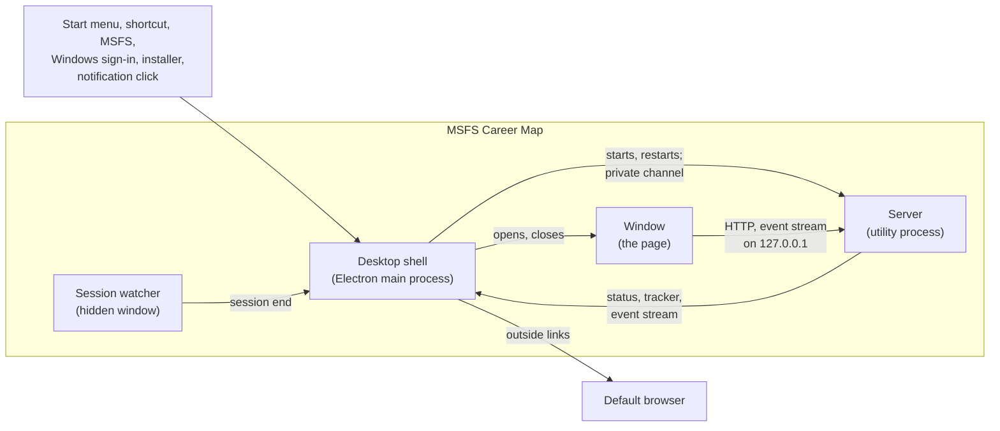

# Desktop

## Context

MSFS Career Map is installed and run as a Windows program. The desktop design is what makes it one: the
installer and uninstaller, the program that starts from the Start menu, at sign-in or with MSFS, the
window the page is shown in, the tray icon that stays while the window is closed, notifications,
updates, and the release builds behind them. It has three parts, each with a design and specs of its
own ([Children](#children)); this document holds what they share.

The **desktop shell** is Electron's main process. It keeps to what a browser cannot do: the window and
tray, the single running copy, keeping the server running, deciding when and where the logbook is backed
up and which logbook to offer on a first run, starting with MSFS or Windows, notifications, updates, and
sending links out to the pilot's browser. It never opens the database and
adds nothing to the page: the window shows the same page, served by the same server, that a browser tab
shows in development, and the page has no bridge to the desktop shell. What the desktop shell shows of
the career — the tray's status line, a notification — it takes from the tracker's own status and event
stream.

The desktop design does not own what the server does — its startup, the data folder's contents, taking
and pruning backups, bringing in a logbook from another data folder, the API and the page (app-shell) —
nor the tracker, the sim link and the PC-wide sim-link claim that lets only one server on the PC link to
the sim at a time (live-tracking). It relies on live-tracking for the tracker's status and events, on
app-shell for the server's inputs, readiness, shutdown, backups and logbook import, on airports for the
seed airport lists and the links the airport popup offers, and on simbrief for a plan safe to show on the
page's origin; [Relies On](#relies-on) lists what the parts share, and each part's own Relies On the
rest.

## Non-Goals

- **Reaching the app from another device**, for now, as in the HLD — the server listens only on
  127.0.0.1; a tablet on the home network is a possible later opt-in.
- **Other operating systems** — the app is a Windows program, as MSFS on PC is.

## Tenets

Three of the HLD's tenets shape it most:

- **Never lose a flight.** Closing the window, a page that fails or a server that crashes never stops
  tracking for longer than it takes to start the server again.
- **Out of the pilot's way while flying.** The desktop shell never brings its window forward by itself
  and asks nothing the pilot did not prompt. An update installs only when the pilot quits, when the
  pilot chooses **Restart to update** with the sim not in use, or by itself at a quiet moment — the sim
  not in use, the window shut, no leg in progress and casual mode off — after which the app comes back
  in the tray (see [The sim is in use](#the-sim-is-in-use),
  [Shell › Staying Out of the Way](shell/shell-design.md#staying-out-of-the-way) and
  [Shell › Updates](shell/shell-design.md#updates)).
- **A guest in the sim's house.** The sim's list of programs to start and Windows' start-up list change
  only when the pilot asks, by the app's one entry, after a backup
  ([Start lists](start-lists/start-lists-design.md)).

## Children

| Part | Prefix | Owns |
|---|---|---|
| [Desktop shell](shell/shell-design.md) | `DESK-SHELL` | The desktop shell at run time: the server's process and keeping it running, deciding when the logbook is backed up, the window and its address rules, the tray icon and menu, the single running copy and its command line, staying out of the way, Windows sign-out, first run, notifications and updates |
| [Start lists](start-lists/start-lists-design.md) | `DESK-START` | Starting with MSFS (the `EXE.xml` editor and its backups) and with Windows (the Run and StartupApproved keys): the two tray items, their words and state, and the start-list work `--unregister` does for the uninstaller |
| [Distribution](distribution/distribution-design.md) | `DESK-DIST` | Packaging (the desktop build output, the server and desktop-shell bundles, the seed airport lists shipped in the program, the icons, fuses and the electron-builder configuration), the installer and uninstaller with the NSIS include that adds to electron-builder's own, releases (the GitHub Actions workflow that builds, tests and drafts them), the desktop development script, the packaged smoke test and the installer round trip |

Each part owns the unit tests of its own logic. The process model, when the sim is in use, the names and
folders, the platform and test mode are shared by all three and kept here. This document owns no specs:
each of these is specified in the part that carries it out.

| What this document holds | Specified in |
|---|---|
| The processes: the server in a utility process that ends with the desktop shell, and what the private channel carries ([Processes](#processes)) | `DESK-SHELL` |
| When the sim is in use ([The sim is in use](#the-sim-is-in-use)) | `DESK-SHELL` |
| The folders, port, sim and airport downloads each mode gives the server, the port taking no fallback, and the data folder and Electron's own folder set as literal paths at start ([Names and folders](#names-and-folders), [Test mode](#test-mode)) | `DESK-SHELL` |
| Only the installed program running outside test mode ([Test mode](#test-mode)) | `DESK-DIST` |
| The appId, the ToastActivatorCLSID, the product and package names, the installer, the install and update-download folders, and the pinned tools, as the packaging configuration and `package.json` hold them ([Names and folders](#names-and-folders), [Platform](#platform)) | `DESK-DIST` |
| The start-list entries' name ([Names and folders](#names-and-folders)) | `DESK-START` |
| What test mode leaves out ([Test mode](#test-mode)) | The part whose behaviour it changes: `DESK-SHELL` for updates, the logbook offer and notifications; `DESK-START` for the start lists |

## System Design

### Processes

| Process | What runs there | Started by |
|---|---|---|
| Desktop shell | Electron's main process: tray, windows, single running copy, start lists, notifications, updates, keeping the server running | The Start menu, a shortcut, MSFS, Windows sign-in, a notification click, the installer or the uninstaller |
| Server | The bundled server — Express API, tracker, sim link, `node:sqlite` — in an Electron utility process | The desktop shell |
| Window | Chromium's renderer showing the page from the server | The desktop shell, when the window opens |
| Session watcher | A hidden window with no page, alive for the whole run, never shown ([Shell › Windows Sign-out and Shutdown](shell/shell-design.md#windows-sign-out-and-shutdown)) | The desktop shell, at start |

The server runs in Electron's own Node, so the installed app needs nothing else installed. Its
synchronous database work and the sim's per-frame data never stall the tray or the window, and a crash
takes down only the server. When the desktop shell's process ends, however it ends, Electron ends the
utility process with it — on Electron 45, within a second of a main process ended outright by
`taskkill /F` or `process.kill` — so a desktop shell that crashes leaves no server tracking behind. The server
cannot see that happen and runs no shutdown then; what keeps the logbook and the leg is listed in
[Relies On](#relies-on), under app-shell.

The desktop shell learns what the tracker is doing the way the page does, from `GET /api/tracker` and
the event stream `/api/tracker/events`. The utility process's own message channel, which only the
desktop shell holds, carries the requests that no web page or other program may make
([Shell › Talking to the server](shell/shell-design.md#talking-to-the-server)).

### The sim is in use

**The sim is in use** — how the desktop shell judges the HLD's "while the sim is connected" — holds in
any of three cases:

- this copy's tracker reports its sim link connected, the sim's menus included;
- it reports another copy holding the PC-wide sim-link claim, which a copy holds only while its link is
  connected to the sim (live-tracking: `link_holder`, LIVE-API-013; the claim, LIVE-LINK-010);
- MSFS 2024 (`FlightSimulator2024.exe`) or MSFS 2020 (`FlightSimulator.exe`) is running for this
  Windows account, whatever this copy's server is doing — starting, running, restarting or given up
  on — and whether or not its link has connected.

The third case covers what the tracker cannot report: the minutes MSFS spends loading before its
SimConnect answers, a link that never connects, and a server that is not running. It counts both sims
the app tracks, while Start with MSFS 2024 looks for MSFS 2024 alone, the one sim it starts the app with
([Start lists › Starting with MSFS](start-lists/start-lists-design.md#starting-with-msfs)).

It governs the rules for staying out of the pilot's way
([Shell › Staying Out of the Way](shell/shell-design.md#staying-out-of-the-way)) and the update steps
([Shell › Updates](shell/shell-design.md#updates)); the tray's status line and dot follow the tracker's
own report instead ([Shell › The Tray](shell/shell-design.md#the-tray)).

### Names and folders

| What | Value |
|---|---|
| appId, also the AppUserModelID | `io.github.sharpwave.msfscareermap` — the uninstall entry's id and the update chain derive from it |
| ToastActivatorCLSID | A GUID chosen once, kept in the packaging configuration beside the appId |
| Product name | MSFS Career Map — the program `MSFS Career Map.exe`, the Start-menu entry, the Apps entry |
| Package name | `msfs-career-map` |
| Installer | electron-builder's assisted NSIS installer, per user |
| Install folder | `%LOCALAPPDATA%\Programs\MSFS Career Map` |
| Start-list entries | The `EXE.xml` entry's `Name` and the Run value's name: MSFS Career Map |
| Port | 3380 |
| Electron's own folder | `%APPDATA%\MSFS Career Map`: the desktop shell's settings, logs and start-up list backups, the page's remembered choices, Chromium's caches |
| Update downloads | `%LOCALAPPDATA%\msfs-career-map-updater`, electron-updater's own, named from the package name |
| Data folder | `%LOCALAPPDATA%\MSFS Career Map` — never the same as, inside or around any folder above |

None of these ever changes: the single-instance lock, the settings, the page's remembered choices, the
uninstall entry, the update chain and the start-list entries are all found by them. A change that cannot
be avoided needs a release whose start-list code also recognises the earlier program path as the app's.
The data folder and Electron's own folder are set as literal paths at start
([Shell › One Running Copy](shell/shell-design.md#one-running-copy)).

### Platform

The parts stand on these tools, chosen as the HLD's **Proven over lean** asks:

| Tool | Version | Does |
|---|---|---|
| Electron | 45.x, an exact release pinned in `package.json` | The runtime: Chromium 156 for the window, Node 24.22 for the server |
| electron-builder | 26.18.0, pinned | Packages the app and builds the NSIS installer |
| electron-updater | 6.8.11, pinned | Finds, downloads and installs updates |
| esbuild | Pinned | Bundles the server and the desktop shell |
| Playwright | The project's | Drives the packaged app in the smoke test, through its Electron support |

electron-builder and electron-updater are installed by exact version, never by npm's `latest` tag,
which can lag behind the newest release. The design depends on no particular
Electron major beyond what its parts use: a utility process with piped output and a private message
channel; `node:sqlite` in its Node; session-end events on a hidden window; suspend and resume events;
the single-instance lock with the second start's command line; login items with a name, arguments and
the enabled mark; notifications with a fixed ToastActivatorCLSID and activation handling; and fuses for
RunAsNode and `NODE_OPTIONS`. Each Electron major is supported for about six months; what that asks of
releases is in [Distribution › Releases](distribution/distribution-design.md#releases).

### Test mode

**Test mode** (`--test-data=<folder>`) runs the app on a folder of its own. Only the installed program
runs outside it: a desktop shell whose own program path, fully resolved and compared without regard to
case, is `MSFS Career Map.exe` in the install folder. Any other build — packaged or not, the smoke
test's unpacked build and `npm run desktop` among them — started without `--test-data` says on the
console it was started from that it runs only in test mode, and exits before it sets a folder or asks
for the single-instance lock ([Distribution › Development](distribution/distribution-design.md#development)).
"The installed copy" and "outside test mode" therefore name the same copies.

Each mode gives the server these folders, port, sim and airport downloads:

| | Installed | Test mode |
|---|---|---|
| Data folder | `%LOCALAPPDATA%\MSFS Career Map` | `<folder>\data` |
| Program folder: the built page and the seed airport lists | The installed program's resources | The packaged program's resources; unpackaged (`npm run desktop`), the repository's desktop build output, `build/desktop/`, a folder of its own apart from the page build in `dist/` ([Distribution › Packaging](distribution/distribution-design.md#packaging)) |
| Backups folder | `MSFS Career Map\Backups` in Documents, found through Windows' known folders at each backup, so a Documents folder moved while the app runs is followed | `<folder>\Backups` |
| Electron's own folder: lock, settings, logs, the page's remembered choices | `%APPDATA%\MSFS Career Map` | `<folder>\desktop` |
| Port | 3380 | 3280 |
| Sim | The sim link (`--sim=link`, LIVE-LINK-012) | The fake feed (`--sim=fake`; `POST /api/tracker/sample`), which never takes the PC-wide sim-link claim (LIVE-LINK-015) |
| Airport downloads | On: a list an import needs and the data folder still lacks after seeding is downloaded at start, and the monthly refresh of the airport lists runs (APT-DATA-003, APT-DATA-020) | Off: neither the monthly refresh nor a download at start (APT-DATA-020) |

It also leaves out what would reach past those folders, each part saying how: the start lists
([Start lists › Test Mode](start-lists/start-lists-design.md#test-mode)), updates
([Shell › The Tray](shell/shell-design.md#the-tray) and [Updates](shell/shell-design.md#updates)), the
logbook to offer ([Shell › First Run](shell/shell-design.md#first-run)), and showing notifications and
writing their registrations ([Shell › Notifications](shell/shell-design.md#notifications)).

The command line chooses it ([Shell › One Running Copy](shell/shell-design.md#one-running-copy)).

## Relies On

What the desktop parts share from other segments, recorded here as cascade notes; each part's own
Relies On lists the rest, and each segment's own design and specs say how.

**app-shell** (the foundation):

- The server can be bundled by esbuild, finding every file it reads or writes through its inputs
  (APP-SRV-008), and reports one version, taken from `package.json`, in `/api/status` and in the
  User-Agent of every request it makes, which names the project's GitHub address as contact, never a
  personal one — the same form the window's own requests use (APP-API-005).
- `/api/status` is one contract in every mode, a copy run from source included (APP-API-004). It answers
  from the moment the server listens, without touching the database (APP-SRV-001, APP-API-008), and
  names the app, its version, the server's process id, the data folder and the sim mode (sim link, fake
  feed or off); it says which start-up step is running (opening, backing up, upgrading or bringing in
  the logbook) and when that work is done, reports airport preparation's progress (APP-API-010), and
  carries a `ready` flag, set once the start-up work is done and airport preparation has ended, which the
  test harnesses wait on (APP-API-009, APP-RUN-017). The flag is neither the desktop shell's readiness —
  `/api/status` answering at all, naming this app and the server it started
  ([Shell › Ready](shell/shell-design.md#ready)) — nor the start-up work done, which the desktop shell
  waits on before it loads the page.
- It shuts down cleanly when the channel asks (APP-SRV-016): the sim link stopped with no disconnect
  reaching the tracker (LIVE-LINK-011), then casual mode switched off, since no server is left to hear
  MSFS close (LIVE-CASUAL-013), then the tracker's final save (LIVE-SAVE-005), the event streams closed,
  and the database closed last. A session end can cut that order short, and a desktop shell that
  crashes or is ended takes the server with it with no shutdown at all, since the server cannot see the
  desktop shell end. What then keeps the logbook and the leg: SQLite's write-ahead log, which loses no
  committed write; the tracker's checkpoint, at most 5 s old and written at once at every change of leg
  (LIVE-SAVE-001); the desktop shell telling each run's first server to start with casual mode off
  (APP-SRV-011, LIVE-CASUAL-015; [Shell › Starting the server](shell/shell-design.md#starting-the-server));
  and the data folder's lock left behind, which the next server finds stale and takes over
  (APP-DATA-007, APP-DATA-008).
- It backs the logbook up before any schema upgrade (APP-BAK-010). Every backup's name carries the id of
  the logbook it holds — one id for each live logbook, new when a data folder's database is created and
  when a logbook is brought in or restored from a backup (APP-DATA-006, APP-BAK-011) — and a UTC time
  ending in `Z`, by which "newest" is judged (APP-BAK-004). Pruning counts and deletes only the backups
  of the logbook being backed up, keeping its seven newest daily backups and three newest others, and
  never deletes a **Back up now** copy or the newest backup taken before an upgrade (APP-BAK-007). When
  the page asks what to offer a new data folder, the server names the newest backup of each logbook other
  than its own that holds hops, with its hop count and newest hop (APP-IMP-001), so a Backups folder kept
  in step between two PCs offers each PC's logbook rather than whichever was backed up last.
- The README covers installing, updating and uninstalling, and also: where the data and backups
  folders are; running the release's installer again to repair an install, which leaves the data folder
  alone and the shortcuts as they are; restoring a backup — Quit, move `career.db` and its `-wal` and
  `-shm` files aside, copy the backup in as `career.db`, then start the app; and adding the app to
  Windows' priority notifications (app-shell's Docs This Segment Owns, which no EARS spec carries).

**airports**:

- The server copies into any data folder whichever airport lists (`airports.csv`, `runways.csv`) it
  lacks from the program folder, keeping any already there, so a first run needs no connection
  (APT-DATA-017, APT-DATA-001, APT-DATA-002). Each list carries the time it was downloaded, a seeded one
  included, and the monthly refresh counts from that time (APT-DATA-018, APT-DATA-003).
- An input of the server's (`--airport-downloads`, APP-SRV-006) turns off the monthly refresh and any
  download at start (APT-DATA-020); test mode and the test harnesses set it (APP-SRV-023, APP-RUN-012,
  APP-RUN-021).

**live-tracking**:

- Only one server on the PC links to the sim at a time. A server holds a PC-wide sim-link claim (a named
  pipe every process on the PC sees) while its link to the sim on this PC is connected: taken when
  SimConnect opens, released at once when the link's connection ends, the link stops or its process ends
  (LIVE-LINK-010); while another server holds it, a server opens no SimConnect connection (LIVE-LINK-001,
  LIVE-LINK-014). Only a real link to the sim on this PC takes it; the fake feed, a server with its sim
  off and `npm run sim-probe` neither take nor check it (LIVE-LINK-015, LIVE-TOOL-004). The installed app
  links by default (`--sim=link`, LIVE-LINK-012); a copy run from source links to the real sim only when
  started with `--sim=link` (`npm run dev:sim`; APP-SRV-007, APP-RUN-019, LIVE-LINK-013), and never
  while another server holds the claim. The tracker's status says when another copy holds the claim, in
  words the tray can show (`link_holder`, LIVE-API-013).
- Pending legs are kept in a list, each with an id never reused (LIVE-HOP-003), so with the window
  closed a second pending leg never replaces the first. What the first release waits for, this among it,
  is listed in [Distribution › Releases](distribution/distribution-design.md#releases).

**simbrief**:

- The SimBrief card shows a plan's OFP text, which runs on the page's own origin, as text and layout
  only: cleaned through an allowlist (SB-CARD-006), its links kept only to other origins (SB-CARD-009),
  nothing in it loading from any address (SB-CARD-010), and drawn inside a box of its own
  (SB-CARD-011). Markup run there could do anything the page can, the server's API included, so the
  first release waits for all four ([Distribution › Releases](distribution/distribution-design.md#releases)).

## Decisions & Alternatives

| Decision | Chosen | Alternatives Considered | Rationale |
|----------|--------|------------------------|-----------|
| Where the server runs | An Electron utility process running the bundled server | The desktop shell's own process; a child started with `ELECTRON_RUN_AS_NODE`; a separate `node.exe` shipped beside the app | Synchronous SQLite and per-frame sim data never stall the tray or window, a crash takes only the server, and the process ends with the desktop shell. It needs neither the RunAsNode switch, off in packaged builds, nor a second Node runtime to ship and update. |
| Learning what the tracker does | The page's API and event stream; the private channel only for backup, saving the tracker's state and shutdown | Everything over the private channel; these requests as HTTP endpoints | Status and events already exist for the page, so there is no second reporting path to keep in step. A shutdown over HTTP would let any program or web page on the PC stop tracking, and the backups the desktop shell waits on answer it alone; only the desktop shell holds the private channel. |
| Port | 3380, fixed, with no fallback | A free port at each start; a remembered fallback port; 3080 | The page remembers choices per origin, so its port must not move. 3080, 5173, 3180, 5183 and 3280 belong to development and the tests. 3380 lies below Windows' range for outgoing connections, so none of those holds it. A port taken at start is shown loudly rather than quietly moving the page's origin. |
| Where the page comes from | `http://127.0.0.1:<port>/`, served by the server | The built files (`file://`); a custom `app://` scheme | The page's API, icon and event-stream addresses are relative to its origin, OpenStreetMap needs the referrer only an http origin sends, and the window shows exactly what a browser tab shows. |
| Bridge into the page | None | A preload giving the page desktop features (settings, folders, notifications) | The page stays a web page that the browser tests cover. SimBrief's plan markup runs on the page's origin, and a bridge would hand it desktop powers. |
| Names and paths | Fixed for good; an unavoidable change ships a release that also recognises the earlier program path | Recording every entry written in the settings, to find it again | The lock, the settings, the page's remembered choices, the update chain and the start-list entries are all found by these names; a name that never changes needs no record. |
| When the sim is in use | This copy's sim link connected, another copy holding the PC-wide sim-link claim, or MSFS 2024 or MSFS 2020 running for this Windows account whatever this copy's server is doing; the tray follows only the tracker's report | This copy's link alone; MSFS's process counted only while this copy's server is starting, restarting or given up on; MSFS 2024's process alone | MSFS loads and streams scenery for minutes before its SimConnect answers, a broken setup may never let the link connect, and while the server restarts or is given up on, or another copy holds the link, this copy reports no link — yet the pilot may be flying, and an update download, a notification's sound or a window taking focus then would interrupt the flight. MSFS 2020 is tracked too (HLD Non-Goals), so its process counts as well. The tray shows what the tracker reports, so its words always match the live card. |
| The desktop shell's own files | Electron's folder | The data folder | The server does everything that touches the data folder, so nothing the desktop shell writes can be taken for part of a logbook, brought in or backed up with it. |
| Chromium's caches and the page's storage | Electron's folder in roaming `%APPDATA%` | A local folder for the caches | All of it can be rebuilt or lost without harm, and keeping every desktop-shell file in one folder leaves the data folder to the server; a roaming profile, which would carry the caches around, is rare on a home PC. |
| Test mode | One switch choosing folder, port, instance and fake feed, with no start lists, updates, logbook offer, notification registrations or airport downloads; only the installed program runs outside it | Environment variables, as for a source run; holding only an unpackaged build to test mode | It cannot be half applied, and a build in test mode never reaches the real logbook, start lists, updater or the installed app's notification registration, nor replaces the airport lists it was seeded with. A build started from anywhere but the install folder — the smoke test's unpacked build, a local package — would otherwise take the installed app's lock, open the real logbook and upgrade it with unreleased code, and point the notification registration at a folder the next build empties. |

## Success Metrics

The desktop parts answer for these of the HLD's success metrics
([HLD › Success Metrics](../../high-level-design.md#success-metrics)); the app is broken when:

- closing the window stops tracking, or a restart of the app or its server loses the leg being flown;
- the app takes focus, asks a question or restarts itself by choice, an update included, while the sim
  is in use ([The sim is in use](#the-sim-is-in-use));
- installing, updating or uninstalling the app loses anything in the logbook;
- the same flight is logged twice because two copies of the app ran at once;
- the sim's list of programs to start or Windows' start-up list gains an entry for the app without the
  pilot asking, keeps it after the pilot turns the setting off or uninstalls, or loses or changes any
  entry the app did not add.

## Open Questions & Future Decisions

### Open

1. **Started by the Store edition of MSFS**, the app is expected to run outside MSFS's package, since a
   program a packaged app starts breaks away from it by default: it writes to the real `%LOCALAPPDATA%`
   and `%APPDATA%`, takes the same single-instance lock as any other start, and keeps running when MSFS
   quits. If it inherited MSFS's package identity or job instead, a redirected data folder would hide the
   logbook, a redirected Electron folder would give a second lock — an empty logbook and a clash on the
   port — or quitting MSFS would end the app. The smoke test
   ([Distribution › Tests](distribution/distribution-design.md#tests)) cannot cover this, so it is a
   check by hand on a real Store install before the first release. Should it be needed, the remedy to
   weigh then is detecting package identity at start and starting the installed program again outside it
   through `explorer.exe`.
2. **Size** — the installer's size, and the app's memory with the map page loaded, are not yet
   measured.

## References

- HLD: [docs/high-level-design.md](../../high-level-design.md) — Approach (a Windows app beside the sim),
  Non-Goals, Tenets, System Design, Segments, Success Metrics, and the decisions Shape of the app, Where
  the logbook lives, Closing the window, Which copy logs flights, When updates install, Starting with the
  sim and Testing
- Children: [shell](shell/shell-design.md), [start-lists](start-lists/start-lists-design.md),
  [distribution](distribution/distribution-design.md)
- Related designs: [app-shell](../app-shell/app-shell-design.md) (server, data folder, backups, logbook
  import, page), [live-tracking](../live-tracking/live-tracking-design.md) (status, event stream, sim
  link and its PC-wide claim), [airports](../airports/airports-design.md) (the seed airport lists and
  their refresh, the airport popup's links),
  [simbrief](../simbrief/simbrief-design.md) (the plan's HTML)
- External: Electron (utility processes, its release and support schedule)
